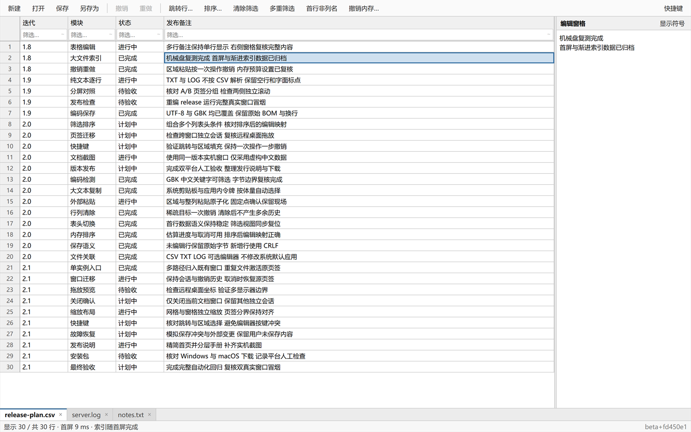
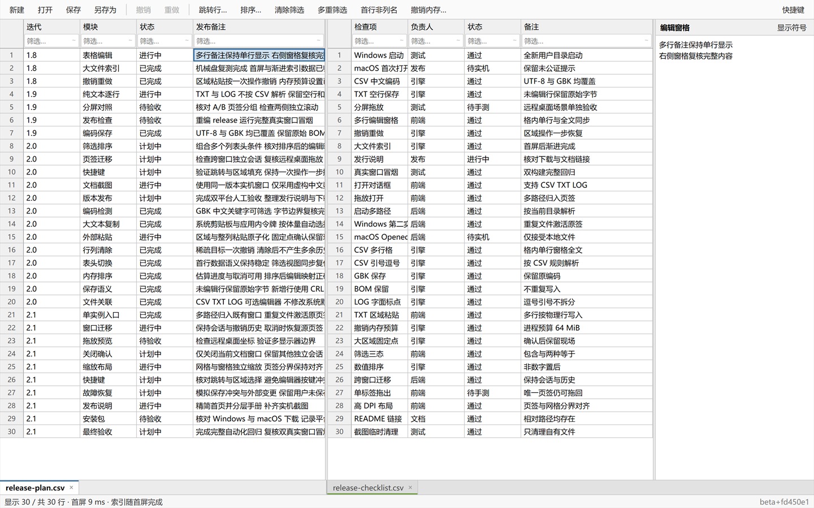
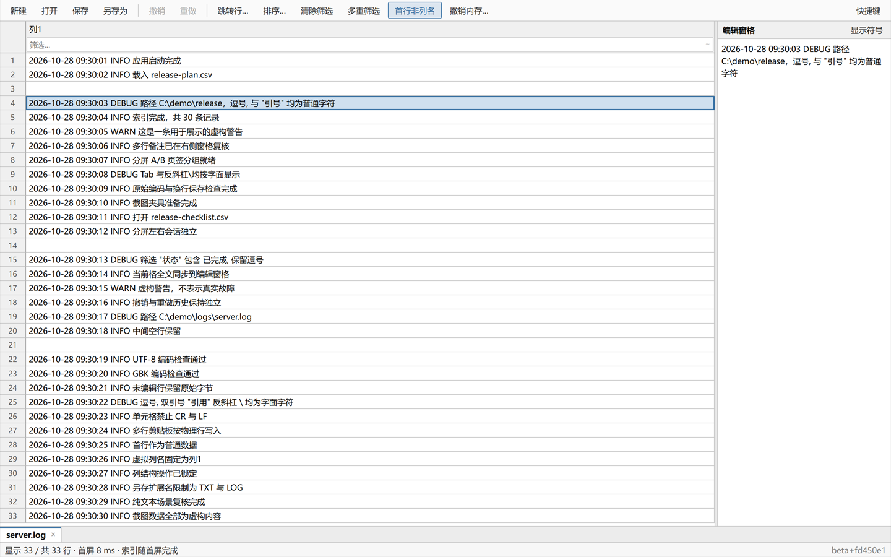

# simpleTable

**像 Excel 一样编辑 CSV 和纯文本：多行格不变形，GB 级文件也能边索引边用。**

simpleTable 是免费开源的桌面表格工具，适合长备注、超大 CSV，以及需要逐行查看的 TXT/LOG。数据留在本机，不监听端口，也不上传文件。

## 下载

| 平台 | 下载 | 运行要求 |
|---|---|---|
| **Windows 10+** | [simpletable.exe](https://github.com/aaahzb/simpleTable/releases/latest) | 免安装；多数系统自带 WebView2，LTSC 等精简系统可能需补装 |
| **macOS Apple Silicon** | [simpleTable-macos-arm64.dmg](https://github.com/aaahzb/simpleTable/releases/latest) | 仅 arm64；未走 Apple 公证，首次打开方式见用户指南 |

Windows 和 macOS 的文件关联都由你手动选择。simpleTable 只声明自己是候选编辑器，不会更改 TXT/LOG 的默认打开程序。

## 核心亮点

- **多行内容，格子不变形**：长备注在格内压成一行，右侧窗格查看和编辑全文。
- **大文件边索引边用**：统一 mmap 与渐进索引引擎，已索引部分可立即滚动和编辑。
- **可持久内存模式**：50 MiB 以上已保存大文件可点「转为内存模式…」，分块转换且可取消；首次转换在目标预留和整个复制期间保留原 M0，直接复制到连续 RAM，全部成功后才安装 RAM 并一次释放 M0，取消或失败不重映射恢复；保存、另存为和退出排序后仍保持内存后备。执行列操作只整理内存正文并保持未保存；保存先生成并提交新 RAM，再写同目录临时文件、flush/sync 后原子换名；写盘失败保留新 RAM 和未保存状态，重试不重复物化未变化正文。保存进度统一按千分比连续推进（计算正文→整理内存→写盘→换名），写盘期间进度条持续前进，不会提前显示 100%。插入/删除/重命名列的 pending 预览立即刷新表头与行数据映射，新空列当场出现在正确位置。执行列操作、保存、清筛等需要文档锁的命令都在后台阻塞线程池运行，主界面不再因为等待长操作而停止响应；内存模式的正文整理按逻辑行分块多核并行（计数遍与生成遍都并行，生成遍各线程直写新正文的独占区间、不产生额外块缓冲），绝对私有内存峰值约为正文的 2×，新增增量仍受 `floor(X × 1.05)` 硬门槛约束；RAM→磁盘写盘保持顺序，非内存模式的保存仍是顺序单线程。若保存发生在“执行列操作”仍在进行时，保存会先等列操作连同界面收尾落定再开始，避免保存成功后又被列操作重新标脏。
- **直接处理数据**：表头筛选、多级排序、区域粘贴、撤销重做、UTF-8/GBK 与原编码保存。
- **多文档与纯文本**：页签、分屏和跨窗口迁移；TXT/LOG 按物理行进入 n×1 表格，不按 CSV 拆引号或逗号。

## 上手 30 秒

1. 下载并打开 simpleTable，把 CSV、TXT 或 LOG 拖进窗口。
2. 点选单元格直接编辑；带换行的内容在右侧窗格查看全文。
3. 在列表头输入关键字筛选，按 `Ctrl+S` 保存。

需要完整快捷键、性能说明、编码规则或 macOS 首次打开说明，请进入用户指南。

## 更多视图

| 分屏对照 | TXT/LOG 纯文本逐行 |
|---|---|
| 两个文档、两组页签，各自保持独立会话。 | 每个物理行一个数据行，固定“列1”，不解析 CSV 引号或逗号。 |
|  |  |

## 文档

- [用户指南](docs/guide.md)：功能、TXT/LOG、筛选排序、大文件、性能、快捷键和 FAQ。
- [开发文档](docs/development.md)：构建、测试、真实 WebView 冒烟、发布链和项目结构。
- [问题反馈](https://github.com/aaahzb/simpleTable/issues)：报告问题或提出需求。

## 开发

Rust + Tauri 2，前端为原生 HTML/CSS/JavaScript。构建与完整验证命令见[开发文档](docs/development.md)。

## 许可证

[MIT](LICENSE) © aaahzb
